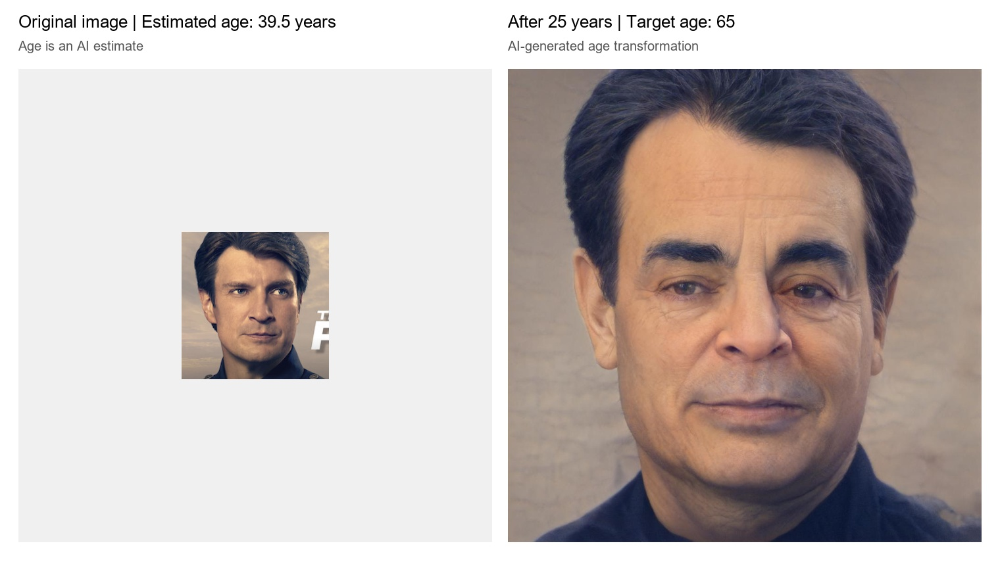
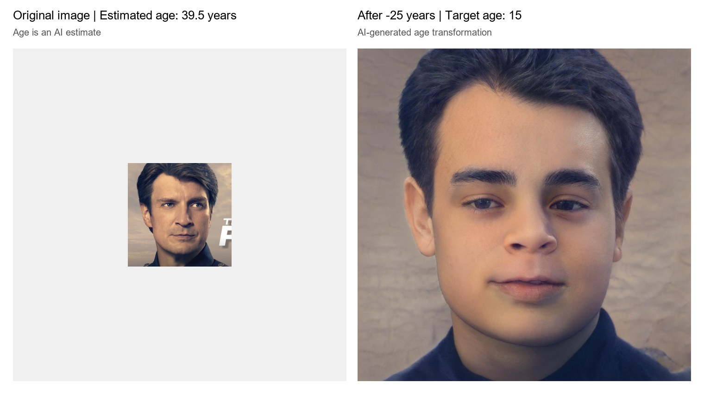

<p align="center">
  
  
</p>


Future-Face estimates a face's age from an image, then uses the age-transformation model to generate a face at a requested age. The launcher is a Windows `.bat` file that starts the Python application inside a Conda environment.

> **Important:** This README documents the current Windows setup and known paths. On another computer, update the paths in `Future-Face.py` and `Future-Face.bat` before running. The age-transformation model's ability to generate younger faces depends on the model/inference implementation; accepting a negative number alone does not guarantee successful age regression.

## 1. Project layout

The current project location is:

```text
E:\Face Convert\Fature-Face\
├── Future-Face.py
├── Future-Face.bat
├── Future-Face_Comparison.jpg          # created after a successful run
├── models\
│   ├── Future-Face-ResNet50-Final.pth
│   └── face_detection_yunet_2023mar.onnx
├── SAM-official\
│   ├── scripts\
│   │   └── inference.py
│   └── pretrained_models\
│       └── sam_ffhq_aging.pt
└── _future_face_temp_input\            # temporary; should be cleaned after run
    _future_face_temp_output\           # temporary; should be cleaned after run
```

The `SAM-official` repository may contain additional source files, model files, and configuration files. Do not remove them.

### Paths used by the current setup

| Item | Current path |
|---|---|
| Project directory | `E:\Face Convert\Fature-Face` |
| Conda environment | `sam_env` |
| Python executable | `C:\Users\SHWET\.conda\envs\sam_env\python.exe` |
| Age estimation checkpoint | `E:\Face Convert\Fature-Face\models\Future-Face-ResNet50-Final.pth` |
| YuNet face detector | `E:\Face Convert\Fature-Face\models\face_detection_yunet_2023mar.onnx` |
| Age transformation checkpoint | `E:\Face Convert\Fature-Face\SAM-official\pretrained_models\sam_ffhq_aging.pt` |
| Inference script | `E:\Face Convert\Fature-Face\SAM-official\scripts\inference.py` |
| Launcher | `E:\Face Convert\Fature-Face\Future-Face.bat` |

These are machine-specific example paths. Change them to match the computer where the project is installed.

## 2. Requirements

- Windows 10/11, 64-bit.
- An NVIDIA GPU and compatible NVIDIA driver are recommended. The current machine uses an NVIDIA GeForce RTX 3060 Laptop GPU.
- Miniconda or Anaconda.
- Visual Studio 2022 Build Tools with the **Desktop development with C++** workload / MSVC C++ compiler. The current launcher initializes:
  `C:\Program Files (x86)\Microsoft Visual Studio\2022\BuildTools\VC\Auxiliary\Build\vcvars64.bat`
- The complete `SAM-official` source repository and all required pretrained/model files.
- The age-estimation checkpoint, YuNet ONNX model, and transformation checkpoint listed above.

The launcher currently uses PyTorch `2.5.1+cu121` and OpenCV `4.10.0`. The log from the working environment showed CUDA available. Your CUDA/PyTorch combination must be compatible with your installed NVIDIA driver.

## 3. Create the Conda environment

Open **Anaconda Prompt** or **Miniconda Prompt**.

If the environment does not exist, create it:

```bat
conda create -n sam_env python=3.10 -y
conda activate sam_env
```

Install PyTorch and torchvision for CUDA 12.1:

```bat
python -m pip install --upgrade pip
python -m pip install torch==2.5.1 torchvision==0.20.1 --index-url https://download.pytorch.org/whl/cu121
```

Install the main Python libraries used by the launcher:

```bat
python -m pip install opencv-python==4.10.0.84 numpy pillow
```

Install any additional dependencies required by the `SAM-official` repository. **Check its own README and requirements file first**, and install those dependencies into the same activated environment. Do not blindly downgrade/upgrade PyTorch after installing the repository's dependencies; verify the final versions afterward.

If the repository has a requirements file, for example:

```bat
cd /d "E:\Face Convert\Fature-Face\SAM-official"
python -m pip install -r requirements.txt
```

Only run that command if the file exists and review its contents for version conflicts first.

### Verify the environment

```bat
python -c "import torch, cv2, numpy, PIL; print('PyTorch:', torch.__version__); print('CUDA available:', torch.cuda.is_available()); print('GPU:', torch.cuda.get_device_name(0) if torch.cuda.is_available() else 'CPU'); print('OpenCV:', cv2.__version__); print('NumPy:', numpy.__version__); print('Pillow:', PIL.__version__)"
```

Expected versions for the known setup include PyTorch `2.5.1+cu121` and OpenCV `4.10.0`. If CUDA reports `False`, the program may run on CPU, but transformation may be much slower.

## 4. Visual Studio C++ Build Tools

The current inference run may compile a PyTorch CUDA/C++ extension. The launcher therefore initializes the Visual Studio compiler before starting Python.

The known Build Tools initialization file is:

```text
C:\Program Files (x86)\Microsoft Visual Studio\2022\BuildTools\VC\Auxiliary\Build\vcvars64.bat
```

To test it manually from Command Prompt:

```bat
call "C:\Program Files (x86)\Microsoft Visual Studio\2022\BuildTools\VC\Auxiliary\Build\vcvars64.bat"
where cl
```

The second command should print a path to `cl.exe`. If it does not, install/repair Visual Studio 2022 Build Tools and its C++ workload, or update the path in `Future-Face.bat`.

## 5. Configure `Future-Face.py`

Open `Future-Face.py` in an editor and confirm these constants near the top match your computer:

```python
PROJECT_DIR = Path(r"E:\Face Convert\Fature-Face")
PYTHON_EXE = Path(r"C:\Users\SHWET\.conda\envs\sam_env\python.exe")
AGE_MODEL_PATH = Path(r"E:\Face Convert\Fature-Face\models\Future-Face-ResNet50-Final.pth")
YUNET_PATH = Path(r"E:\Face Convert\Fature-Face\models\face_detection_yunet_2023mar.onnx")
SAM_CHECKPOINT = PROJECT_DIR / "SAM-official" / "pretrained_models" / "sam_ffhq_aging.pt"
```

Use raw strings (`r"..."`) for Windows paths to avoid backslash escape issues. `PYTHON_EXE` must point to the Python executable inside the intended Conda environment—not to a different system Python.

The age-change dialog is intended to accept:
- `+10`: request an age 10 years older.
- `-10`: request an age 10 years younger.
- `0`: request the current estimated age / no age shift.

The current age target is clamped to the supported range in the launcher. Confirm that the transformation inference code supports the requested direction and target-age range; input validation and model capability are separate issues.

## 6. Configure `Future-Face.bat`

Open `Future-Face.bat` in Notepad or an IDE and verify that it:
1. Sets the project directory to the correct location.
2. Uses the matching `sam_env` Python executable.
3. Calls `vcvars64.bat` before running Python so `cl.exe` is available.
4. Verifies required checkpoints and the YuNet model exist.
5. Runs `Future-Face.py` using the configured Python executable.
6. Keeps the console open on errors so the traceback can be read.

Example core launch pattern (adapt to the existing full launcher; do not replace its other checks without reviewing them):

```bat
@echo off
set "PROJECT_DIR=E:\Face Convert\Fature-Face"
set "PYTHON_EXE=C:\Users\SHWET\.conda\envs\sam_env\python.exe"
set "VCVARS=C:\Program Files (x86)\Microsoft Visual Studio\2022\BuildTools\VC\Auxiliary\Build\vcvars64.bat"

if not exist "%PYTHON_EXE%" (
    echo ERROR: Python executable not found: "%PYTHON_EXE%"
    pause
    exit /b 1
)
if not exist "%VCVARS%" (
    echo ERROR: Visual Studio C++ environment script not found: "%VCVARS%"
    pause
    exit /b 1
)

call "%VCVARS%"
if errorlevel 1 (
    echo ERROR: Could not initialize Visual Studio C++ Build Tools.
    pause
    exit /b 1
)

cd /d "%PROJECT_DIR%"
"%PYTHON_EXE%" -u "%PROJECT_DIR%\Future-Face.py"
if errorlevel 1 echo Future-Face exited with an error.
pause
```

This is a minimal example, not a guaranteed replacement for the full existing `Future-Face.bat`. Preserve any extra validation already present in your launcher.

## 7. Run the application

1. Ensure the Conda environment and repository dependencies are installed.
2. Confirm the model files exist at the configured paths.
3. Double-click `Future-Face.bat`, or open Command Prompt and run the BAT by its full path.
4. Select an image in the file picker.
5. The launcher detects a face using YuNet, crops a square face region, resizes it to `224 × 224`, and estimates age with the ResNet50 model.
6. Enter the desired age shift: positive for future/older, negative for past/younger.
7. Wait for transformation inference to finish.
8. On success, the launcher creates and opens `Future-Face_Comparison.jpg`, then asks whether to test another image.

The launcher is configured to clean temporary inference outputs after processing. The expected retained result is `Future-Face_Comparison.jpg`. If a run fails before cleanup, inspect the console traceback before manually deleting temporary folders.

## 8. Troubleshooting

### `where cl` fails / C++ compiler not found
- Confirm Visual Studio 2022 Build Tools and the C++ workload are installed.
- Confirm the `vcvars64.bat` path.
- Ensure the BAT calls `vcvars64.bat` before launching Python.

### `CUDA available: False`
- Check the NVIDIA driver.
- Activate the correct Conda environment.
- Reinstall the intended PyTorch CUDA build if needed.
- Verify with the command in Section 3.

### Missing checkpoint or YuNet model
Check the exact path and filename. Keep the checkpoints in the expected folders or update the constants/launcher paths.

### Transformation finishes, but comparison image fails
Read the full traceback. The original face passed to `create_comparison()` may already be a PIL image object, while the generated face is a path. The function should handle those input types separately:

```python
if isinstance(original_path, Image.Image):
    left = original_path.convert("RGB")
else:
    left = Image.open(original_path).convert("RGB")
right = Image.open(generated_path).convert("RGB")
```

### Negative age shift is accepted, but the result does not look younger
The dialog accepting negative input does not prove that the transformation model supports age regression. Check the model's age-conditioning and inference implementation. Do not assume a correct younger result unless it has been tested.

### Error dialog only says `read`
Print the full traceback using `traceback.format_exc()` in the exception handler. The traceback identifies which line attempted to call `.read()` on an incompatible object.

## 9. Prompt to give an AI coding IDE

Copy the prompt below into your coding IDE after opening the project folder. It tells the IDE to inspect the real files, update machine-specific paths, validate dependencies, and prepare the launcher without blindly rewriting the project.

```text
You are maintaining an existing Windows Python project named Future-Face. Work directly in the currently opened project folder. Do not assume the paths below are correct for this computer; inspect the actual folder structure and ask me for any missing paths.

GOAL
Configure the existing Future-Face project and its Future-Face.bat launcher so the application can run reliably on this Windows machine.

FIRST, DISCOVER AND CONFIRM THESE VALUES
1. PROJECT_DIR: the absolute path to the folder containing Future-Face.py and Future-Face.bat.
2. CONDA_ROOT: the actual Anaconda/Miniconda installation or Conda root.
3. CONDA_ENV_NAME: sam_env, unless I specify another name.
4. PYTHON_EXE: the actual python.exe inside that environment. Derive/verify it using `conda run -n sam_env python -c "import sys; print(sys.executable)"` or `conda env list`; do not guess a user profile path.
5. AGE_MODEL_PATH: models/Future-Face-ResNet50-Final.pth relative to PROJECT_DIR.
6. YUNET_PATH: models/face_detection_yunet_2023mar.onnx relative to PROJECT_DIR.
7. TRANSFORM_CHECKPOINT: SAM-official/pretrained_models/sam_ffhq_aging.pt relative to PROJECT_DIR.
8. INFERENCE_SCRIPT: SAM-official/scripts/inference.py relative to PROJECT_DIR.
9. VCVARS_PATH: locate the installed Visual Studio Build Tools vcvars64.bat. The known previous path was `C:\Program Files (x86)\Microsoft Visual Studio\2022\BuildTools\VC\Auxiliary\Build\vcvars64.bat`, but verify it exists.

PATH CONFIGURATION
- Update the path constants at the top of Future-Face.py: PROJECT_DIR, PYTHON_EXE, AGE_MODEL_PATH, YUNET_PATH, and SAM_CHECKPOINT.
- Use pathlib.Path and raw Windows path strings where appropriate.
- Update Future-Face.bat to use the same project directory and Python executable.
- Ensure the BAT initializes Visual Studio C++ Build Tools with `call "%VCVARS_PATH%"` before Python starts, then verifies `where cl` succeeds.
- Keep the filename Future-Face.bat. Do not put the word “SAM” in the launcher title or user-facing launcher text.
- Do not hardcode paths for a different computer. Keep paths in one clearly documented configuration section where practical.

ENVIRONMENT AND DEPENDENCIES
- Inspect the repository README, requirements files, setup files, and imports before installing anything.
- The previous working environment used Python from a Conda environment named sam_env, PyTorch 2.5.1+cu121, torchvision 0.20.1, OpenCV 4.10.0, NumPy, Pillow, CUDA, and an NVIDIA GeForce RTX 3060 Laptop GPU.
- Verify actual installed versions before changing packages.
- If sam_env does not exist, ask before creating it or create it only if I authorize it. For the previous setup, the intended base commands were:
  `conda create -n sam_env python=3.10 -y`
  `conda activate sam_env`
  `python -m pip install torch==2.5.1 torchvision==0.20.1 --index-url https://download.pytorch.org/whl/cu121`
  `python -m pip install opencv-python==4.10.0.84 numpy pillow`
- Resolve any conflicts with the repository's own requirements carefully. Do not overwrite or download model checkpoints unnecessarily.
- Verify imports, `torch.cuda.is_available()`, GPU name, `cv2.__version__`, and `where cl`.

FUNCTIONAL REQUIREMENTS
- Preserve the existing GUI image picker and YuNet face detection.
- Crop the detected main face into a square region and resize it to 224x224 for age estimation.
- Preserve the existing ResNet50 age-estimation checkpoint and normalization.
- The age-shift input must accept integers from -80 through +80: positive means older/future, negative means younger/past, zero means no shift. Verify that the transformation model and inference script actually support both directions; do not claim age regression works just because negative input is accepted.
- Clamp target age to the supported range already implemented by the project, and clearly display the requested direction and target age.
- Run `SAM-official/scripts/inference.py` using the configured Python executable, transformation checkpoint, temporary input folder, and target age.
- Inspect the real inference output paths and ensure the launcher locates the generated image correctly.
- Fix image-type handling in create_comparison(): if the original face is already a PIL.Image.Image, use `.convert("RGB")` directly; otherwise open the path with Image.open(). Open the generated image from its file path.
- On success, create and open only `Future-Face_Comparison.jpg`. Clean only temporary inference output folders/files created by this launcher. Never delete checkpoints, source code, original input images, or repository assets.
- Keep useful tracebacks in the console on errors. Do not hide errors behind a vague message.
- After each attempt, allow the user to choose whether to select another image.
- Preserve the existing project architecture and modify the smallest number of files necessary.

VALIDATION
1. Print all resolved paths and confirm each required file exists.
2. Verify the Conda interpreter can import torch, torchvision, cv2, numpy, and PIL.
3. Verify CUDA/GPU information if available.
4. Verify Visual Studio compiler initialization and `where cl`.
5. Run a syntax check on Future-Face.py.
6. Run the BAT launcher and test with one image only if I approve execution.
7. Do not report a test as successful unless it actually ran and produced the comparison image.

DELIVERABLES
- Updated Future-Face.py and Future-Face.bat.
- Updated README.md with setup, Conda environment creation, dependencies, configuration paths, launch steps, and troubleshooting.
- A concise summary of changed files and any remaining manual steps.
- Do not overwrite unrelated files. Before replacing an existing file, inspect it and preserve important existing behavior.
```

## 10. Before sharing the project

- Keep large model checkpoints in the expected locations; they may not belong in source control.
- Do not share personal Windows paths as universal paths. Replace them with instructions for discovering each user's paths.
- Include the repository's license and any required model/dataset attribution when redistributing.
- Keep the original input images private unless you intentionally choose to share them.
=======
# Future-Face
